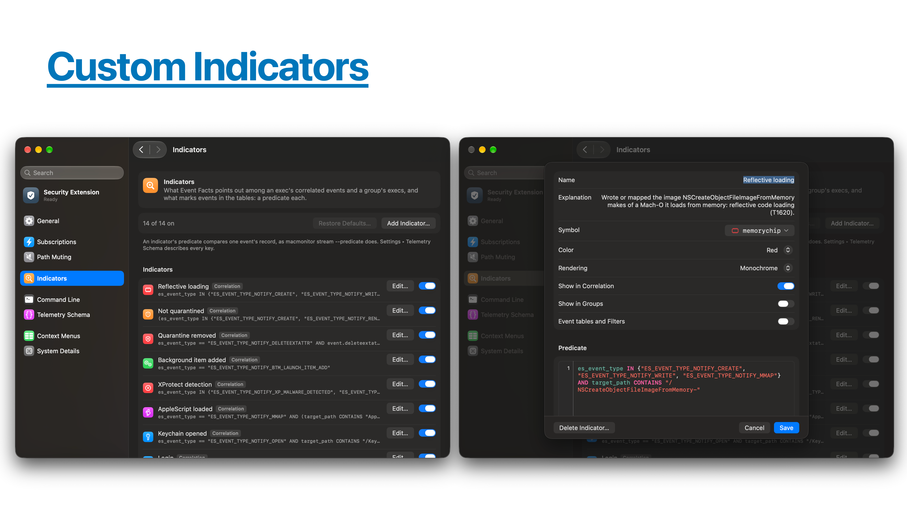

## Welcome to Mac Monitor


Mac Monitor is an **advanced, stand-alone system monitoring tool tailor-made for macOS security research, malware triage, and system troubleshooting**. Built on Apple's Endpoint Security (ES) and System Extension APIs, it collects and enriches process, interprocess, memory, XPC and file events, and helps you surface only the ones relevant to you.

### OBTS v8.0 Presentation
**Introducing the Next Generation of Mac Monitor**:
* [📊 Slides](https://swiftlydetecting-conferences.s3.us-west-2.amazonaws.com/public/2025/OBTSv8/Introducing+the+Next+Generation+of+Mac+Monitor.pdf)
* [📺 YouTube](https://www.youtube.com/watch?v=h_i_H6RzzHA)


## Requirements
- **Processor**: We recommend an `Apple Silicon` machine, but `Intel` works too!
- **System memory**: `4GB+` is recommended
- **macOS version**: `13.1+` (Ventura)


## How can I install this thing?

**☕️ (Recommended) Homebrew**
* `brew install --cask mac-monitor`

**📦 Installer package**
* Download the latest installer from [releases](https://github.com/Brandon7CC/mac-monitor/releases).

**Install**
* Open `Mac Monitor.app` and "Allow" the System Extension when prompted.
* Turn on [Full Disk Access](https://developer.apple.com/documentation/endpointsecurity/3259700-es_new_client) for `Mac Monitor Security Extension` in System Settings.
* 🏎️ Click "Start". Done!

(`3.0+`) Settings > General > **Check Now** looks for updates.


### Install footprint
- **App**: `/Applications/Mac Monitor.app` (`com.swiftlydetecting.agent`)
- **Security Extension**: `com.swiftlydetecting.agent.securityextension`
- (`3.0+`) **Command line tool**: inside the app, linked to `/usr/local/bin/macmonitor` if you install it from Settings
- (`3.0+`) **Saved mute set**: `/Library/Application Support/com.swiftlydetecting.agent.securityextension/mutes.json`


## Uninstall
* **From the Finder** delete the app and authenticate to remove the System Extension. It's that easy!
* Or run `Mac Monitor.app/Contents/SharedSupport/uninstall.sh`, which also removes the saved mute set and the `macmonitor` link.


## Path mutes
(`3.0+`) Mac Monitor keeps one **saved mute set**. It survives restarts, applies right away, and is shared with `sudo macmonitor`.

- **Settings > Path Muting** shows it. Right click an event to add a mute.
- **Import, export or reset** it there too. Import reads 2.1 exports, so export your mutes from 2.1 before updating.
- Endpoint Security matches resolved paths: use `/private/tmp/...`, not `/tmp/...`.


## Command line
(`3.0+`) `macmonitor` streams events to a terminal or a pipe while Mac Monitor keeps recording. Install it from Settings > Command Line.

```
sudo macmonitor stream                     # Mac Monitor's default events
sudo macmonitor stream exec fork exit      # only these events
sudo macmonitor stream all | jq -c .       # every event, as JSONL
sudo macmonitor stream exec --for 30s      # 30 seconds of execs
sudo macmonitor stream close --every close # every close, not only those of modified files

# an osascript script asking for a password, as macOS stealers do
sudo macmonitor stream exec --target '/osascript$' \
    --predicate 'event.exec.script_content CONTAINS[c] "display dialog" AND event.exec.script_content CONTAINS[c] "password"'

sudo macmonitor mute list                  # the saved mute set
sudo macmonitor indicators list            # this Mac's indicators, with each one's severity
sudo macmonitor indicators show 'Plist modified'  # every detail of one, by name or ID
sudo macmonitor indicators edit 'Plist modified' --severity medium  # change one, keeping its ID
sudo macmonitor stream --indicator 'Plist modified'  # events the Security Extension matched to it
macmonitor validate trace.jsonl            # check an export against the schema
macmonitor status                          # versions, what the Security Extension needs, and who is capturing
```

- Text on a terminal, JSONL when piped: the same records as Export telemetry, an `eslogger` superset.
- `macmonitor help <command>` covers every option.
- (`3.1+`) `macmonitor status` needs no root and changes nothing: it shows the versions of `macmonitor`, Mac Monitor and the Security Extension, whether the Security Extension is activated and has Full Disk Access, whether Mac Monitor is connected and recording, and how many `macmonitor` streams are running. `--json` writes the same for a script, and it exits 69 when the Security Extension isn't ready. `macmonitor -v` shows the version, as `--version` does.
- (`3.1+`) `stream`, `mute` and `indicators` need root by default. Settings > Command Line > Without sudo lets any user stream, and separately change mutes and indicators, without `sudo`. The Security Extension keeps and enforces it, and only accepts its own signed `macmonitor`. While it's on, any user on the Mac, and any program they run, can read every process's events.


## What are some standout features?
- **High fidelity ES events, enriched**: code signing, quarantine, script content, and the process that really launched each one.
  - (`3.1+`) Every process carries `process_age_ms`, how old it was at the event: search `process.process_age_ms < 1000` for young processes.
  - (`3.1+`) Background task (BTM) add and remove events describe the bundle a launch item names and its parent app: Info.plist essentials, signing, quarantine, download origin and the bundle's age, with the Info.plist in the PLIST tab. Search `event.btm_launch_item_add.item.bundle.is_ui_element == true` for login items that hide from the Dock.
  - (`3.1+`) mmap events name their protections and flags, such as `PROT_READ | PROT_EXEC`: search `ANY event.mmap.protection_names == "PROT_EXEC"` for executable mappings.
  - (`3.1+`) setmode events show the new mode as `rwxr-xr-x`, the mode before the change, and what the change added: search `ANY event.setmode.mode_added == "executable"` for files made executable.
  - (`3.1+`) IOKit open events name the service being opened and its driver's bundle ID, read from the IOKit registry at capture, and Event Facts says what notable user clients such as `IOHIDLibUserClient` give. The Non-Apple driver opened indicator marks opens of a third-party kext's or DriverKit extension's service; search `event.iokit_open.parent_class == "IOHIDSystem"` for a service by class.
  - (`3.1+`) mmap events, modified closes and renames say what the file is by its content, never its name: the Launch Services
    type of its first 4 KB, such as `com.apple.mach-o-dylib` or `public.zsh-script`, and a Mach-O's `MH_*` file type,
    read when the event is recorded. Event Facts shows it as File type; search `event.close.mach_o_type == "MH_EXECUTE"`
    for executables written to disk. The Archive written indicator marks zip, tar, gzip, bzip2, xz and 7-Zip files,
    installer packages, Apple Archives, and UDIF, raw, sparse, encrypted and sparse bundle disk images written,
    whatever their names; Office, OpenDocument and EPUB documents are zip files too, and are named as documents. The
    AppleScript written indicator marks compiled AppleScript and JXA written, as a `.scpt` or an applet's
    `main.scpt`, run-only or not, and AppleScript whose `#!` line names osascript, whatever their names; text
    AppleScript without a `#!` line is plain text, and isn't marked. Neither marks what macOS's own daemons write all
    day: Time Machine's copies, fseventsd's gzipped event logs, Spotlight's cached text and a sparse bundle's bands,
    nor the system logs macOS compresses in `/private/var/log` every night.
- **Dynamic event subscriptions**: change what you subscribe to on the fly to cut down on noise.
  - (`3.1+`) Close is on by default, for modified files only. Change that in Settings > Subscriptions; `macmonitor stream --every close` streams every close for that stream only.
- **Path muting at the API level**: `es_mute_path` and `es_mute_path_events`, with every `ES_MUTE_PATH_TYPE_*`. **I'd love it if the ES team added inversion on a per-event basis instead of per-client**.


- **Event facts**: double click any event for its metadata, script, correlated events, process group and JSON. Right click for filtering, muting and unsubscribing.
- **Event correlation**: every event a process caused, linked to it, with a summary and indicator cards.
- **Process subtree**: Event Facts' sidebar shows the process's lineage. Click any process to open its facts.


- (`3.0+`) **Indicators**: predicates that point out events worth a look. Change Mac Monitor's own or write your own in Settings > Indicators.
  - (`3.1+`) Choose how the event tables mark each indicator's events, in any mix: Edit > Event tables > Dot,
    Symbol and Label color. Label color draws the event's type, or an exec's process name, in the indicator's color.
  - (`3.1+`) A predicate can name its event type by its payload, `event.btm_launch_item_add != nil`, and compare any
    key path of the telemetry schema, `event.exec.launched_by_parent.path` among them, in the Security Extension too.
  - (`3.1+`) Adhoc or unsigned is now two indicators, Adhoc signed and Unsigned. They color an exec's label
    orange and red, which the label used to do by itself: turn that off, or change the color, in Settings.
  - (`3.1+`) Persistence indicators for what Background Task Management doesn't report: shell startup files, cron and
    at jobs, sudo, PAM and authorization changes, SSH keys and sshd's configuration, sideloaded browser extensions,
    launchd jobs loaded from outside the launch folders, dylibs inserted at launch, plug-ins macOS loads on its own,
    commands Terminal and iTerm2 run as they start, login and logout hooks, configuration profiles, and Folder Actions.
  - (`3.1+`) Unsigned code resolved a name: an adhoc signed or unsigned process connecting to mDNSResponder, the
    system resolver, through its socket or its XPC service. It says a name was looked up, not which one. Signed code
    whose signature is no longer valid counts too. Self-signed code, which has no team ID but isn't adhoc, doesn't.
  - (`3.1+`) Password checked with dscl: `dscl -authonly` or `-auth`, as stealers run to confirm the password a fake
    prompt captured. TCC database modified: a TCC database written, renamed or linked into place by anything but
    tccd, as malware with Full Disk Access, or on a Mac with SIP off, does to grant itself permissions.
  - (`3.1+`) The osascript indicator is retired: AppleScript / JXA marks every process that loads the scripting
    components, osascript included. A copy you edited stays as one of your own.



- **Filtering**: hide events by type, process or path without losing them, or drop events while recording.
  - (`3.0+`) Or filter with a predicate in the predicate editor (View > Predicate Editor, ⌥⌘F).


- **Export and open traces**: export JSON or JSONL, and (`3.0+`) open Mac Monitor or `eslogger` traces (File > Open Trace...).
- **Event distribution chart**: spot noisy events at a glance. Show or hide it with the chart button in the toolbar.


## Some other features
- (`3.0+`) **Built for long traces**: events go to an on-disk store, and the event tables fetch off the main thread.
- The Security Extension **does not process events when a trace isn't running**, so it doesn't use resources or battery in the background.
- Mac Monitor ships as a **notarized distribution package**, so you know what's being installed.


## Telemetry schema
(`3.0+`) Every record Mac Monitor exports, and `macmonitor` writes, follows a [JSON Schema](https://json-schema.org/draft/2020-12): `eslogger`'s JSON plus Mac Monitor's enrichments, each key marked `x-mac-monitor-origin`.

- Each release attaches it as [`Mac-Monitor.telemetry.schema.json`](https://github.com/Brandon7CC/mac-monitor/releases/latest/download/Mac-Monitor.telemetry.schema.json). The repository keeps it in [`Schema/`](./Schema).
- Check a trace with Help > Telemetry Schema... or `macmonitor validate <trace>`.


