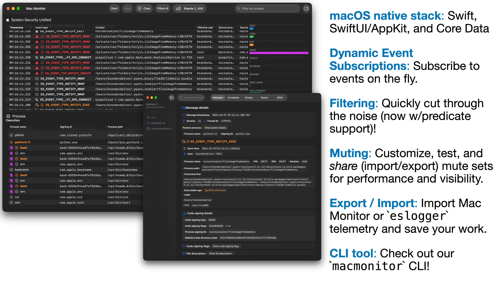
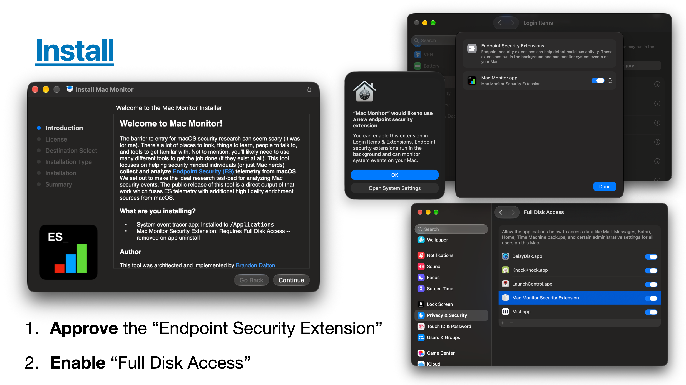
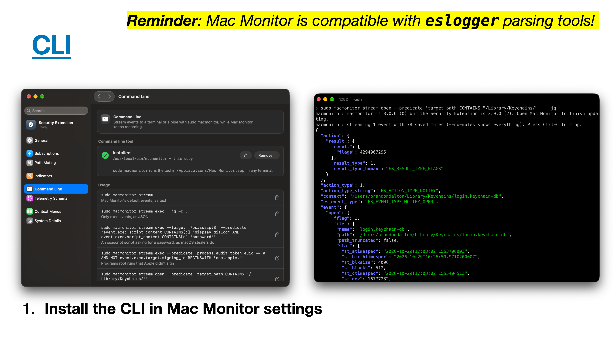
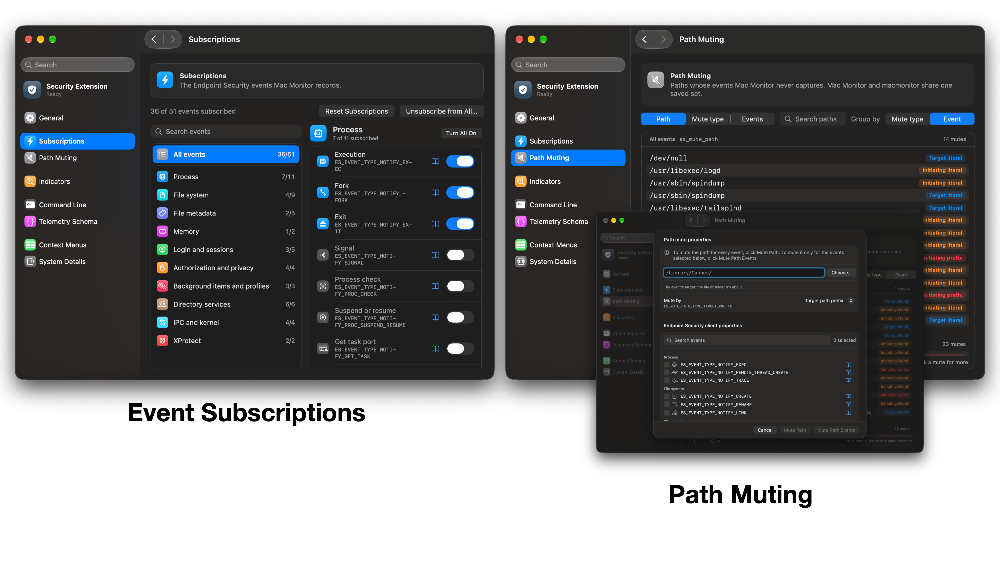
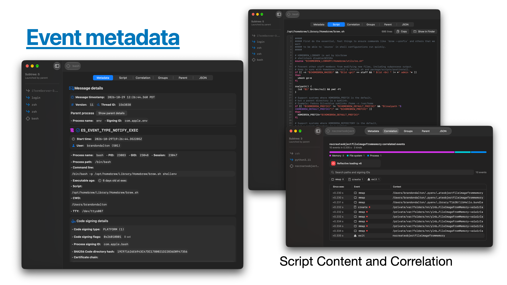
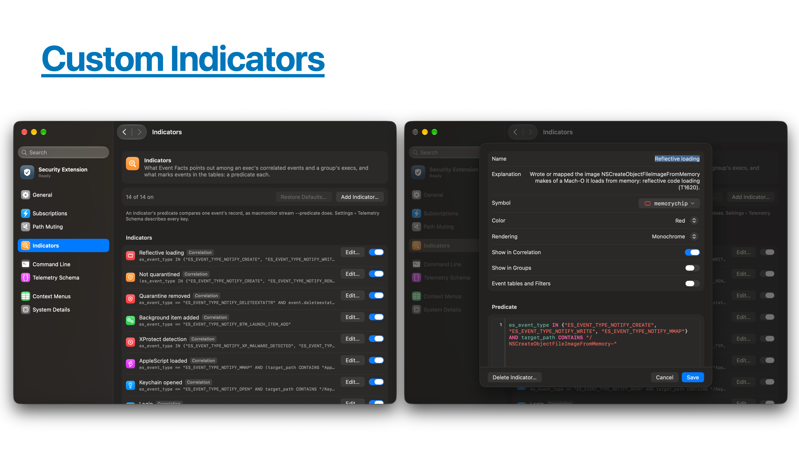
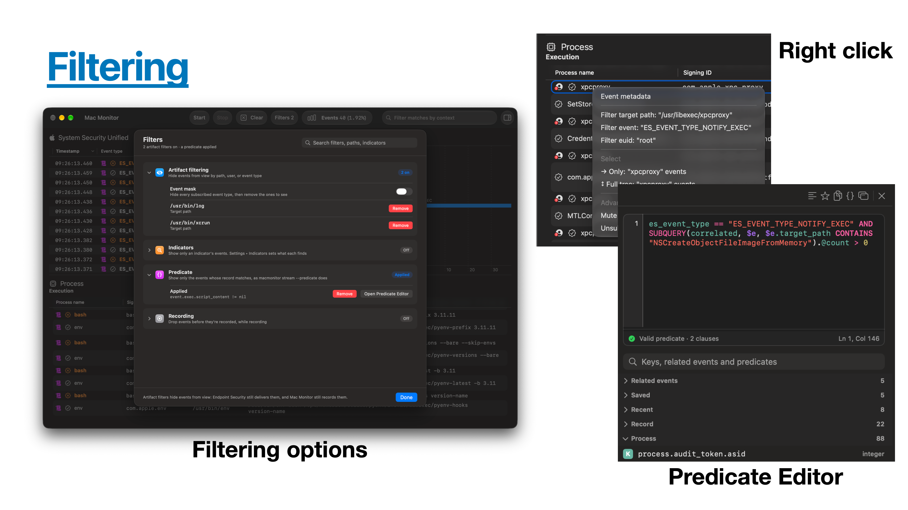
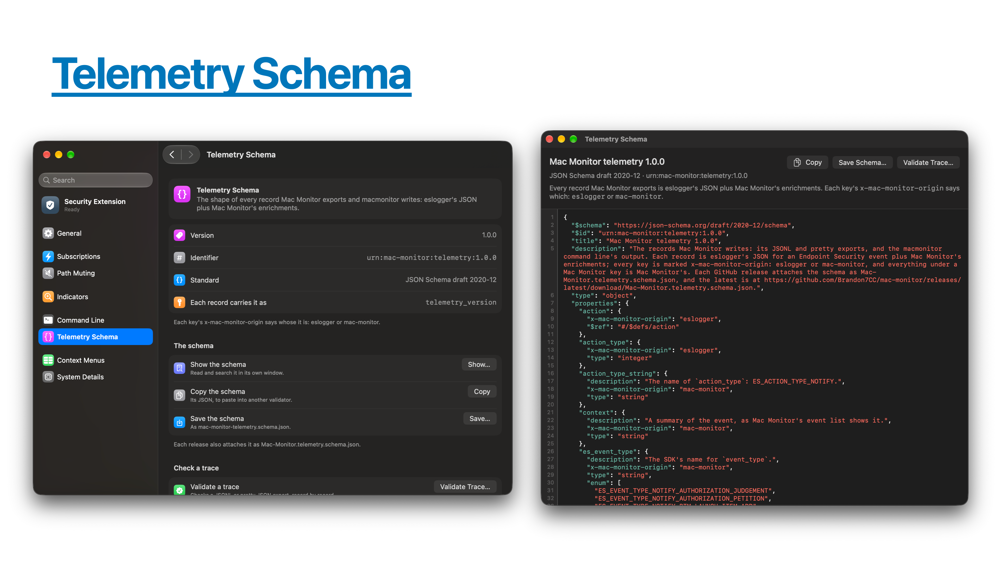

## Welcome to Mac Monitor


Mac Monitor is an **advanced, stand-alone system monitoring tool tailor-made for macOS security research, malware triage, and system troubleshooting**. Built on Apple's Endpoint Security (ES) and System Extension APIs, it collects and enriches process, interprocess, memory, XPC and file events, and helps you surface only the ones relevant to you.

### OBTS v8.0 Presentation
**Introducing the Next Generation of Mac Monitor**:
* [📊 Slides](https://swiftlydetecting-conferences.s3.us-west-2.amazonaws.com/public/2025/OBTSv8/Introducing+the+Next+Generation+of+Mac+Monitor.pdf)
* [📺 YouTube](https://www.youtube.com/watch?v=h_i_H6RzzHA)


## Requirements
- Processor: We recommend an `Apple Silicon` machine, but `Intel` works too!
- System memory: `4GB+` is recommended
- macOS version: `13.1+` (Ventura)


## How can I install this thing?

**☕️ (Recommended) Homebrew**
* `brew install --cask mac-monitor`

**📦 Installer package**
* Download the latest installer from [releases](https://github.com/Brandon7CC/mac-monitor/releases).

**Install**
* Open `Mac Monitor.app` and "Allow" the System Extension when prompted.
* Turn on [Full Disk Access](https://developer.apple.com/documentation/endpointsecurity/3259700-es_new_client) for `Mac Monitor Security Extension` in System Settings.
* 🏎️ Click "Start". Done!

(`3.0.0+`) Settings ▸ General ▸ **Check Now** looks for updates.



### Install footprint
- App: `/Applications/Mac Monitor.app` (`com.swiftlydetecting.agent`)
- Security Extension: `com.swiftlydetecting.agent.securityextension`
- (`3.0.0+`) Command line tool: inside the app, linked to `/usr/local/bin/macmonitor` if you install it from Settings
- (`3.0.0+`) Saved mute set: `/Library/Application Support/com.swiftlydetecting.agent.securityextension/mutes.json`


## Uninstall
* **From the Finder** delete the app and authenticate to remove the System Extension. It's that easy!
* Or run `Mac Monitor.app/Contents/SharedSupport/uninstall.sh`, which also removes the saved mute set and the `macmonitor` link.


## Path mutes
(`3.0.0+`) Mac Monitor keeps one **saved mute set**. It survives restarts, applies right away, and is shared with `sudo macmonitor`. Only an administrator can change it.

- **Settings ▸ Path Muting** shows it. Right click an event to add a mute.
- **Import, export or reset** it there too. Import reads 2.1 exports, so export your mutes from 2.1 before updating.
- Endpoint Security matches resolved paths: use `/private/tmp/…`, not `/tmp/…`.


## Command line
(`3.0.0+`) `macmonitor` streams events to a terminal or a pipe while Mac Monitor keeps recording. Install it from Settings ▸ Command Line.

```
sudo macmonitor stream                     # Mac Monitor's default events
sudo macmonitor stream exec fork exit      # only these events
sudo macmonitor stream all | jq -c .       # every event, as JSONL
sudo macmonitor stream exec --for 30s      # 30 seconds of execs

# an osascript script asking for a password, as macOS stealers do
sudo macmonitor stream exec --target '/osascript$' \
    --predicate 'event.exec.script_content CONTAINS[c] "display dialog" AND event.exec.script_content CONTAINS[c] "password"'

sudo macmonitor mute list                  # the saved mute set
macmonitor validate trace.jsonl            # check an export against the schema
```

- Text on a terminal, JSONL when piped: the same records as Export telemetry, an `eslogger` superset.
- `macmonitor help <command>` covers every option.




## What are some standout features?
- **High fidelity ES events, enriched**: code signing, quarantine, script content, and the process that really launched each one.
- **Dynamic event subscriptions**: change what you subscribe to on the fly to cut down on noise.
- **Path muting at the API level**: `es_mute_path` and `es_mute_path_events`, with every `ES_MUTE_PATH_TYPE_*`. **I'd love it if the ES team added inversion on a per-event basis instead of per-client**.



- **Event facts**: double click any event for its metadata, script, correlated events, process group and JSON. Right click for filtering, muting and unsubscribing.
- **Event correlation**: every event a process caused, linked to it, with a summary and indicator cards.
- **Process subtree**: Event Facts' sidebar shows the process's lineage. Click any process to open its facts.



- (`3.0.0+`) **Indicators**: predicates that point out events worth a look. Change Mac Monitor's own or write your own in Settings ▸ Indicators.



- **Filtering**: hide events by type, process or path without losing them, or drop events while recording.
  - (`3.0.0+`) Or filter with a predicate in the predicate editor (View ▸ Predicate Editor, ⌥⌘F).



- **Export and open traces**: export JSON or JSONL, and (`3.0.0+`) open Mac Monitor or `eslogger` traces with File ▸ Open Trace….
- **Event distribution chart**: spot noisy events at a glance. Show or hide it with the chart button in the toolbar.


## Some other features
- (`3.0.0+`) **Built for long traces**: events go to an on-disk store, and the event tables fetch off the main thread.
- The Security Extension **does not process events when a trace isn't running**, so it doesn't use resources or battery in the background.
- Mac Monitor ships as a **notarized distribution package**, so you know what's being installed.


## Telemetry schema
(`3.0.0+`) Every record Mac Monitor exports, and `macmonitor` writes, follows a [JSON Schema](https://json-schema.org/draft/2020-12): `eslogger`'s JSON plus Mac Monitor's enrichments, each key marked `x-mac-monitor-origin`.

- Each release attaches it as [`Mac-Monitor.telemetry.schema.json`](https://github.com/Brandon7CC/mac-monitor/releases/latest/download/Mac-Monitor.telemetry.schema.json). The repository keeps it in [`Schema/`](./Schema).
- Check a trace with Help ▸ Telemetry Schema… or `macmonitor validate <trace>`.


